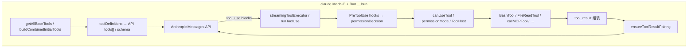

> 靶标：Anthropic 官方 darwin-arm64 `claude` 2.1.301
> 方法：Craft Anything **Deep**（字符串 / Mach-O / 功能追踪）+ CLI
> 日期：2026-11-04 · **证据驱动，不猜测未解析的 JS AST**

---

## 0. 靶标与 provenance


| 项              | 值                                                                                           |
| --------------- | -------------------------------------------------------------------------------------------- |
| 工作区副本      | `/Users/user/1104/binaries/claude-code-2.1.301-darwin-arm64/claude`                          |
| 来源            | VS Code 扩展`anthropic.claude-code-2.1.301-darwin-arm64` 内 `resources/native-binary/claude` |
| SHA-256         | `1f04c69e1c24e4d0a716a863af0aad8fc64d49a499334c29701f073700276b99`                           |
| `file`          | Mach-O 64-bit executable**arm64**                                                            |
| `--version`     | `2.1.301 (Claude Code)`                                                                      |
| Provenance 说明 | `binaries/claude-code-2.1.301-darwin-arm64/PROVENANCE.md`                                    |
| Craft 项目      | `docs/craft-claude-code-binary.cany`                                                         |
| 原始证据转储    | `docs/claude-code-re/`                                                                       |

---

## 1. 运行 CLI（二进制可执行性）

```text
$ ./binaries/claude-code-2.1.301-darwin-arm64/claude --version
2.1.301 (Claude Code)

$ ./…/claude auth status
{ "loggedIn": false, "authMethod": "none", … }

$ ./…/claude -p "reply with exactly: pong"
Not logged in · Please run /login
```

CLI **已成功加载并执行**该二进制，对**本地 harness 内嵌实现**的静态逆向。

`--help` / `mcp --help` 暴露的工具相关开关与二进制字符串一致：`--allowedTools`、`--disallowedTools`、`--tools`、`--permission-mode`、`--permission-prompt-tool`、`--mcp-config`、`--strict-mcp-config`、`--include-hook-events` 等（见 `docs/claude-code-re/cli-runtime.txt`）

---

## 2. Craft Anything 画像


| 观察                                                                | 证据                                    |
| ------------------------------------------------------------------- | --------------------------------------- |
| Mach-O execute，arm64，stripped（无内部函数名）                     | `core_target_triage` → `ev_0da801d0…` |
| 链接库仅系统库：`libicucore` / `libresolv` / `libc++` / `libSystem` | triage +`apple_macho_show`              |
| 构建：macos minos 13.0，SDK 26.5，`lld 23.1.2`                      | `apple_macho_show` → `ev_07f409b7…`   |
| 代码签名存在（约 508 KB）                                           | 同上                                    |
| 关键数据段：`__bun`（Bun 嵌入载荷）                                 | 几乎所有工具字符串落在`section: __bun`  |
| 另有`__jsc_int`（JS 相关）                                          | `native_sections_list`                  |

**结构结论（有据）：** Claude Code CLI 是 **Bun 打包的原生可执行文件**：业务逻辑以 JS/TS 形式嵌入 `__bun`，外层为 Mach-O + JavaScriptCore/Bun 运行时。因此：

- 符号表 stripped → 原生 xref 到「函数名」几乎为空（`core_feature_find tool_use`：**121 字符串命中，0 函数**）；
- **工具调用实现真相在 `__bun` 字符串 / 嵌入源**，而不是传统 C/C++ 导出符号。

---

## 3. 工具调用实现

从二进制还原的架构，下列符号均出现在 `__bun`（Craft `native_strings_find`，E 级：二进制观测）。

### 3.1 与 Messages API 契约的对齐点


| 二进制字符串                                                             | 含义（结合官方 API 文档）                                  |
| ------------------------------------------------------------------------ | ---------------------------------------------------------- |
| `tool_use` / `tool_result` / `tool_use_id`                               | 标准内容块类型与配对键                                     |
| `server_tool_use` / `mcp_tool_use`                                       | 服务端工具 / MCP 工具块类型                                |
| `stop_reason` / `final_stop_reason` / `last_reply_stop_reason`           | 循环退出条件                                               |
| `tool_choice`                                                            | API 请求字段                                               |
| `defer_loading`                                                          | Tool search / 延迟加载                                     |
| `input_schema`（含 regex `\btools\.(\d+)\.(?:custom\.)?input_schema\b`） | schema 路径校验                                            |
| `parent_tool_use_id`                                                     | 子代理流式输出挂到父 tool_use（`--print` + `stream-json`） |

### 3.2 Harness 入口

```text
getAllBaseTools / getTools / toolDefinitions / inlineToolDefinitions
buildCombinedInitialTools / combinedInitialTools
createStreamingToolExecutor / streamingToolExecutor / rebuildStreamingToolExecutor
runToolUse
ensureToolResultPairing          ← 强制 tool_use ↔ tool_result 配对
normalizeToolInput
getStrictToolResultPairing
findUnresolvedToolUse(s)
filterIncompleteToolCalls
```

**实现：**

1. 启动时用 `getAllBaseTools` / `buildCombinedInitialTools` 组装工具面；
2. 对话循环里由 `streamingToolExecutor` / `runToolUse` 执行模型返回的 tool_use；
3. `ensureToolResultPairing` 在严格模式下检测/修补缺失的 `tool_result`（字符串明文：`pairing mismatch detected (strict mode)` / `repaired missing tool_result blocks`）——这与官方 Messages API「tool_result 必须紧跟 tool_use」契约一致，且 harness **主动修复**会话历史

### 3.3 权限与 Hooks


| 符号                                                                                                            | 角色                           |
| --------------------------------------------------------------------------------------------------------------- | ------------------------------ |
| `canUseTool` / `createCanUseToolWithPermissionPrompt` / `getCanUseToolFn`                                       | 权限回调（Agent SDK 同名概念） |
| `permissionMode` / `permissionDecision` / `permissionDecisionReason`                                            | 会话权限模式与单次裁决         |
| `PreToolUse` / `PostToolUse` / `PostToolUseFailure`                                                             | 生命周期钩子事件名             |
| `executePreToolHooks` / `executePostToolHooks` / `executePostToolBatchHooks` / `executePostToolUseFailureHooks` | 钩子执行器                     |
| `executePermissionRequestHooks` / `createPermissionRequestMessage`                                              | 批准 UI / 消息                 |
| `checkReadPermissionForTool` / `checkWritePermissionForTool` / `checkRuleBasedPermissionsOnToolHost`            | 按路径/规则检查                |

Hook 文档字符串嵌入二进制（`## Hooks Configuration`），并说明 `permissionDecision` allow/deny/ask。

### 3.4 MCP 工具面


| 符号                                                                        | 角色                  |
| --------------------------------------------------------------------------- | --------------------- |
| `mcp__` 前缀；正则 `^mcp__[\w-]+(?:__(?:[\w.-]+                             | \*))?$`               |
| `tools/list` / `tools/list_changed` / `tools/call`                          | MCP JSON-RPC 方法     |
| `callMCPTool` / `composeMcpTool` / `acquireMcpServerToolsSwapper`           | 调用与热更新          |
| `ListMcpResourcesTool` / `ReadMcpResourceTool`                              | 内置 MCP 资源工具类名 |
| `ListToolsRequestSchema` / `CallToolRequestSchema` / `CallToolResultSchema` | MCP schema 类型名     |
| `mcpServers` / `mcpServersPending` / …                                     | 配置面                |

### 3.5 ToolHost（远程 / 多宿主工具）

大量 `*ToolHost*` 符号（`registerToolHosts`、`handleToolHostPermissionRequest`、`createRemoteToolHostsRuntime`、`startForegroundToolHost` 等）表明：工具执行可托管在 **本机以外的 ToolHost**（Remote Control / 云会话等），权限请求可跨宿主回传。

### 3.6 与 Managed Agents 的交叉痕迹

字符串 **`betaAgentToolset20260401`** 出现在同一二进制中——与官方 Managed Agents 的 `agent_toolset_20260401` 命名同源。说明 Claude Code 客户端代码库**共享/感知**托管 agent toolset 类型（具体调用路径需进一步从 `__bun` 解包才能断言）。

---

## 4. 内置工具类名（`__bun` 中观测到的 `*Tool`）

从正则 `[A-Z][A-Za-z0-9]+Tool` 提取并人工过滤后的**部分**产品工具类（完整启发式列表见 `docs/claude-code-re/tool-classes-clean.txt` / `tool-class-names.txt`）：


| 类名（二进制）                                                           | 对应官方 Tools reference 名（文档层） |
| ------------------------------------------------------------------------ | ------------------------------------- |
| `BashTool`                                                               | `Bash`                                |
| `FileReadTool`                                                           | `Read`                                |
| `FileEditTool` / `FileWriteTool`                                         | `Edit` / `Write`                      |
| `GrepTool` / `GlobTool`                                                  | `Grep` / `Glob`                       |
| `NotebookEditTool`                                                       | `NotebookEdit`                        |
| `WebFetchTool`                                                           | `WebFetch`                            |
| `WebSearchTool`（见权限文案）                                            | `WebSearch`                           |
| `PowerShellTool`                                                         | `PowerShell`                          |
| `SkillTool`                                                              | `Skill`                               |
| `AgentTool`（多处引用）                                                  | `Agent`                               |
| `ToolSearchTool`                                                         | `ToolSearch`                          |
| `WorkflowTool`                                                           | `Workflow`                            |
| `ArtifactTool`                                                           | `Artifact`                            |
| `CronCreateTool` / `CronDeleteTool` / `CronListTool`                     | `Cron*`                               |
| `MonitorTool`                                                            | `Monitor`                             |
| `ListAgentsTool` / `SendMessageTool` / `SendUserFileTool`                | 跨会话 / Remote                       |
| `RemoteTriggerTool` / `PushNotificationTool`                             | 云调度 / 通知                         |
| `EndConversationTool`                                                    | `EndConversation`                     |
| `ListMcpResourcesTool` / `ReadMcpResourceTool`                           | MCP 资源                              |
| `ListConnectorsTool` / `SuggestConnectorsTool` / `SearchMcpRegistryTool` | Connectors 生态                       |

另有辅助符号：`builtInToolNames$`、`defaultPresetToolNames`、`codeExecutionToolNames`、`getClaudeInChromeMCPToolOverrides`、`getComputerUseMCPToolOverrides` —— 表明 Chrome / Computer Use 以 **MCP 覆盖层**挂入，而非全部硬编码为同构原生工具。

---

## 5. 还原后的调用流水线（二进制证据 + 官方契约）



1. **注册**：`getAllBaseTools` + MCP `tools/list` + connectors → `combinedInitialTools`。
2. **请求**：把工具定义编进 Messages 请求（见 `toolDefinitions` / `defer_loading` / `tool_choice`）。
3. **响应**：读 `stop_reason`；若为工具调用则进入 `runToolUse` / streaming executor。
4. **门禁**：`PreToolUse` → `permissionDecision` / `canUseTool`（可经 `--permission-prompt-tool` 外置）。
5. **执行**：内置 `*Tool` 类或 `callMCPTool` / ToolHost。
6. **回写**：构造 `tool_result`；`ensureToolResultPairing` 保证历史合法后再续轮。

---

## 6. 方法边界（防幻觉）


| 已证实                                     | 未证实 / 未做                                             |
| ------------------------------------------ | --------------------------------------------------------- |
| 文件身份、SHA、版本、Mach-O/Bun 结构       | 完整`__bun` JS AST 解包与伪代码                           |
| 上表符号与字符串字面量存在于二进制         | 每个符号的精确调用图（stripped + Bun 数据段导致 xref≈0） |
| CLI 能启动并识别工具相关 flags             | 登录后端到端一次真实 tool_use 网络轨迹                    |
| 与公开 Tools / MCP / Messages 文档高度同构 | 服务端如何采样 tool JSON（不在此二进制内）                |

Craft Anything 对 `tool_use` 的 feature-find 明确报告：**有字符串、无函数命中**——这是 Bun 嵌入架构的预期结果，不是「没有实现」。

---

## 7. 证据索引


| 产物               | 路径                                      |
| ------------------ | ----------------------------------------- |
| Triage             | `docs/claude-code-re/triage.md`           |
| Mach-O             | `docs/claude-code-re/macho.md`            |
| Sections           | `docs/claude-code-re/sections.md`         |
| 字符串猎捕         | `docs/claude-code-re/strings-*.txt`       |
| Feature tool_use   | `docs/claude-code-re/feature-tool_use.md` |
| CLI 运行记录       | `docs/claude-code-re/cli-runtime.txt`     |
| Craft 证据库       | `docs/craft-claude-code-binary.cany/`     |
| 契约层总览（文档） | `docs/anthropic-tool-calling.md`          |

---

## 8. 结论

**Anthropic Claude Code 的「调用工具」闭源实现，在 darwin-arm64 官方二进制里体现为：Bun 嵌入的 TypeScript harness（`__bun`），以 `getAllBaseTools` → Messages `tool_use` → `streamingToolExecutor`/`runToolUse` → Hooks/权限/`*Tool` 或 MCP → `tool_result`/`ensureToolResultPairing` 闭环；与公开 Messages API 契约同构，产品差异在本地权限、MCP 命名（`mcp__…`）与 ToolHost，而不在另一套模型协议。**
